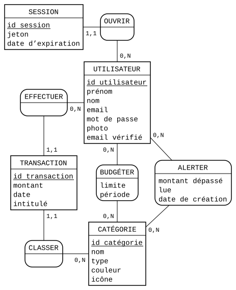

# Base de données — La Pince

Conception et description de la base : règles de gestion, modèles conceptuel (MCD), logique (MLD) et physique (MPD), dictionnaire de données, intégrité, sécurité, comptes et droits. La section 11 décrit le second stockage de l'application, clé/valeur : Redis, pour les compteurs du limiteur de tentatives.

Sources de vérité : le schéma [apps/api/prisma/schema.prisma](../apps/api/prisma/schema.prisma) et les migrations SQL [apps/api/prisma/migrations/](../apps/api/prisma/migrations/). Ce document les explique ; en cas d'écart, ce sont eux qui font foi.

---

## 1. Pourquoi une base relationnelle (PostgreSQL)

- **Des données liées par nature** : un utilisateur a des dépenses, chacune rangée dans une catégorie ; un budget porte sur une catégorie. Les clés étrangères garantissent ces liens (pas de dépense rattachée à une catégorie qui n'existe pas).
- **De l'argent** : montants exacts au centime (`DECIMAL(12, 2)`), là où un nombre à virgule flottante donnerait 0,10 + 0,20 = 0,30000000000000004.
- **Des écritures qui vont ensemble** : une dépense et l'alerte de son budget sont enregistrées dans une même transaction (tout ou rien), avec un verrou contre les requêtes simultanées (section 7).
- **Des calculs** : totaux par mois, par catégorie, dépassements, que SQL et les index font efficacement.

PostgreSQL 17, piloté par l'ORM Prisma (requêtes typées, migrations versionnées).

---

## 2. Règles de gestion

| # | Règle |
|---|---|
| RG1 | Un utilisateur s'inscrit avec un prénom, un nom, un email et un mot de passe. L'email est **unique** et insensible à la casse : enregistré en minuscules, ce que la base impose (contrainte `CHECK`). Le compte reste non vérifié tant que l'email n'est pas confirmé. |
| RG2 | Le mot de passe compte au moins 8 caractères, dont une majuscule, un chiffre et un caractère spécial. Il n'est jamais stocké en clair (haché avec Argon2). |
| RG3 | Les **catégories** sont communes à tous les utilisateurs (39, créées par le seed), de type **dépense** ou **revenu**, avec un nom unique. Les utilisateurs ne les modifient pas. |
| RG4 | Une **transaction** appartient à un seul utilisateur et à une seule catégorie ; son type (dépense ou revenu) est celui de sa catégorie. Montant strictement positif, au centime, inférieur à 10 milliards ; date au jour ; intitulé facultatif (255 caractères au plus). |
| RG5 | Un utilisateur a **au plus un budget par catégorie**. Un budget a une limite (positive, au centime) et une période : **mensuelle** (mois civil en cours) ou **hebdomadaire** (du lundi au dimanche). |
| RG6 | Un budget est **dépassé** quand ses dépenses de la période en cours excèdent sa limite. Il existe alors **une alerte** (au plus une par utilisateur et par catégorie), avec le montant du dépassement, lue ou non. Elle disparaît quand le dépassement disparaît (dépense supprimée, limite relevée, budget supprimé, nouvelle période). |
| RG7 | Un utilisateur peut être connecté sur plusieurs appareils : **5 sessions au plus**, la plus ancienne est fermée au-delà. Une session expire au bout de 7 jours. |
| RG8 | Mot de passe oublié : un lien à **usage unique**, valable **30 minutes** ; changer de mot de passe ferme toutes les sessions. |
| RG9 | Supprimer son compte supprime **toutes ses données** (sessions, transactions, budgets, alertes). Une catégorie utilisée par une transaction ou un budget ne peut pas être supprimée. |

---

## 3. Modèle conceptuel de données (MCD)



Formalisme Merise, cardinalités (minimum, maximum) lues depuis l'entité : un utilisateur **effectue** 0 à N transactions ; une transaction est effectuée par 1 et 1 seul utilisateur.

- **BUDGÉTER** est une association porteuse entre UTILISATEUR et CATÉGORIE (attributs : limite, période). Elle traduit RG5 : le couple (utilisateur, catégorie) identifie un budget, il ne peut donc y en avoir qu'un.
- **ALERTER** est, de la même façon, une association porteuse entre UTILISATEUR et CATÉGORIE (attributs : montant dépassé, lue, date de création). Elle traduit RG6 : il existe au plus une alerte par utilisateur et par catégorie, ce que la base garantit par une contrainte `UNIQUE (user_id, category_id)`. Le verrou par utilisateur et par catégorie (section 7) garantit en plus que le montant est calculé sur des données à jour.
- **SESSION** représente une connexion ouverte sur un appareil (RG7).

Source du schéma : [mcd/la-pince.mcd](mcd/la-pince.mcd), au format texte de [Mocodo](https://www.mocodo.net/), versionné avec le code. Pour regénérer l'image (SVG et PNG) après une modification, depuis la racine du dépôt (PowerShell) :
```powershell
docker run --rm -v "${PWD}/docs/mcd:/mcd" -w /mcd python:3.12-slim sh -c "apt-get -qq update && apt-get -qq install -y libcairo2 && pip install -q mocodo cairosvg && mocodo -i la-pince.mcd --language fr --svg_to png"
```

---

## 4. Modèle logique de données (MLD)

Clés primaires soulignées, clés étrangères précédées de `#` :

- **UTILISATEUR** (<u>id utilisateur</u>, prénom, nom, email, mot de passe, photo, email vérifié)
- **SESSION** (<u>id session</u>, jeton, date d'expiration, #id utilisateur)
- **CATÉGORIE** (<u>id catégorie</u>, nom, type, couleur, icône)
- **TRANSACTION** (<u>id transaction</u>, montant, date, intitulé, #id utilisateur, #id catégorie)
- **BUDGÉTER** (<u>#id utilisateur, #id catégorie</u>, limite, période)
- **ALERTER** (<u>#id utilisateur, #id catégorie</u>, montant dépassé, lue, date de création)

Passage du MCD au MLD : chaque entité devient une table ; une association 1,1 – 0,N devient une clé étrangère du côté 1,1 ; les associations porteuses BUDGÉTER et ALERTER (0,N – 0,N) deviennent chacune une table dont la clé est le couple des deux clés étrangères.

---

## 5. Modèle physique (MPD) et convention de nommage

Le MPD est le SQL exécuté par PostgreSQL : les **migrations** versionnées, appliquées dans l'ordre par `prisma migrate deploy` au démarrage de l'API.

| Migration | Contenu |
|---|---|
| [0_init](../apps/api/prisma/migrations/0_init/migration.sql) | création des types énumérés, des 6 tables, des index, des contraintes d'unicité et des 7 clés étrangères |
| [20261030140000_naming_convention_and_money](../apps/api/prisma/migrations/20261030140000_naming_convention_and_money/migration.sql) | convention de nommage ci-dessous et montants en `DECIMAL(12, 2)`, écrite à la main (renommages seulement, aucune donnée supprimée) |
| [20261031120000_hash_session_tokens](../apps/api/prisma/migrations/20261031120000_hash_session_tokens/migration.sql) | jetons de session et de confirmation d'email stockés sous forme d'empreinte SHA-256 (`token_hash`, `email_verification_token_hash`), écrite à la main : renommages, puis jetons existants hachés sur place, les sessions ouvertes restent valides |
| [20261109200000_alert_unique_per_category](../apps/api/prisma/migrations/20261109200000_alert_unique_per_category/migration.sql) | contrainte `UNIQUE (user_id, category_id)` sur `alerts` (RG6 garantie par la base), écrite à la main : les doublons éventuels, données dérivées, sont d'abord supprimés en gardant l'alerte la plus récente |
| [20261109210000_email_normalized_check](../apps/api/prisma/migrations/20261109210000_email_normalized_check/migration.sql) | contrainte `CHECK (email = lower(btrim(email)))` sur `users` (RG1 garantie par la base), écrite à la main : normalise d'abord les emails existants ; si deux comptes ne diffèrent que par la casse, elle échoue sans rien modifier (essayé sur une base jetable) |
| [20261109220000_alert_exceeded_amount_precision](../apps/api/prisma/migrations/20261109220000_alert_exceeded_amount_precision/migration.sql) | `alerts.exceeded_amount` élargi à `DECIMAL(15, 2)` : le dépassement est une somme de dépenses, il peut excéder le montant maximal d'une dépense ; 15 chiffres, car tous les centimes restent alors exacts en nombre JavaScript |
| [20261110120000_private_migrations_table](../apps/api/prisma/migrations/20261110120000_private_migrations_table/migration.sql) | droits seulement : retire à `lapince_app` tout accès à l'historique `_prisma_migrations` (section 9), écrite à la main ; sans effet si le rôle ou la table n'existe pas |

**Convention de nommage** :
- tables au pluriel, en minuscules : `users`, `transactions`, `categories` ;
- colonnes en snake_case : `created_at`, `email_verified` ;
- clé primaire `id`, entier auto-incrémenté ;
- clés étrangères `<entité>_id` : `user_id`, `category_id` ;
- types énumérés en snake_case : `period_type`, `category_type` ;
- contraintes et index nommés d'après la table et les colonnes : `budgets_user_id_category_id_key`, `transactions_user_id_fkey`.

Le code garde ses noms (champs Prisma, donc API) : `@map` et `@@map` dans `schema.prisma` font la correspondance (`userId` ↔ `user_id`).

**Écarts assumés entre MLD et MPD** :
- `budgets` a une clé technique `id` (identifiant stable dans l'API : `/budgets/12`) ; l'identifiant du MLD (utilisateur, catégorie) devient une **contrainte d'unicité** `UNIQUE (user_id, category_id)`, qui garantit RG5 de la même façon. Même traitement pour `alerts` (`/alerts/7/read`) : clé technique `id`, et `UNIQUE (user_id, category_id)` pour RG6.
- Colonnes techniques absentes du MCD : dates de création et de modification, jetons de vérification et de réinitialisation (section 6).
- Table `_prisma_migrations` : historique des migrations appliquées, géré par Prisma.

---

## 6. Dictionnaire de données

Types PostgreSQL. `NN` : obligatoire (`NOT NULL`). `PK` : clé primaire, `FK` : clé étrangère, `UQ` : unique.

### `users` — utilisateurs

| Colonne | Type | Contraintes | Description |
|---|---|---|---|
| `id` | `INTEGER` | PK, auto-incrément | identifiant |
| `first_name` | `TEXT` | NN | prénom |
| `last_name` | `TEXT` | NN | nom |
| `email` | `TEXT` | NN, UQ, CHECK | email de connexion, en minuscules, sans espaces autour (RG1) : contrainte `users_email_normalized_check` |
| `password` | `TEXT` | NN | **hash Argon2** du mot de passe, jamais le mot de passe (RG2) |
| `photo` | `TEXT` | | photo de profil (facultative) |
| `email_verified` | `BOOLEAN` | NN, défaut `false` | email confirmé |
| `email_verification_token_hash` | `TEXT` | | **hash SHA-256** du jeton aléatoire (UUID v4) du lien de confirmation ; effacé une fois l'email vérifié |
| `password_reset_token_hash` | `TEXT` | UQ | **hash SHA-256** du jeton de réinitialisation ; le jeton en clair n'existe que dans l'email (RG8) |
| `password_reset_expires_at` | `TIMESTAMP(3)` | | fin de validité du lien de réinitialisation (30 min) |
| `created_at` | `TIMESTAMP(3)` | NN, défaut maintenant | création du compte |
| `updated_at` | `TIMESTAMP(3)` | NN | dernière modification (mise à jour par Prisma) |

### `refresh_tokens` — sessions

| Colonne | Type | Contraintes | Description |
|---|---|---|---|
| `id` | `INTEGER` | PK | identifiant |
| `token_hash` | `TEXT` | NN, UQ | **hash SHA-256** du jeton de rafraîchissement de la session (JWT signé, qui n'existe en clair que dans le cookie) ; sa présence en base permet de fermer une session (déconnexion, changement de mot de passe) ; supprimé à chaque utilisation (rotation) |
| `user_id` | `INTEGER` | NN, FK → `users`, suppression en cascade | propriétaire |
| `expires_at` | `TIMESTAMP(3)` | NN | fin de validité (7 jours, RG7) |
| `created_at`, `updated_at` | `TIMESTAMP(3)` | NN | dates de création et de modification |

### `categories` — catégories

| Colonne | Type | Contraintes | Description |
|---|---|---|---|
| `id` | `INTEGER` | PK | identifiant |
| `name` | `TEXT` | NN, UQ | nom affiché (« Logement », « Salaire »…) |
| `type` | `category_type` | NN | `EXPENSE` (dépense) ou `INCOME` (revenu) ; donne le type des transactions (RG3, RG4) |
| `color` | `TEXT` | | couleur d'affichage |
| `icon` | `TEXT` | | icône d'affichage |
| `created_at`, `updated_at` | `TIMESTAMP(3)` | NN | dates de création et de modification |

### `transactions` — dépenses et revenus

| Colonne | Type | Contraintes | Description |
|---|---|---|---|
| `id` | `INTEGER` | PK | identifiant |
| `amount` | `DECIMAL(12, 2)` | NN | montant positif, au centime ; le signe vient du type de la catégorie (RG4) |
| `date` | `TIMESTAMP(3)` | NN | jour de la transaction (saisi au jour, enregistré à minuit UTC) |
| `description` | `TEXT` | | intitulé facultatif ; sans lui, l'interface affiche la catégorie |
| `user_id` | `INTEGER` | NN, FK → `users`, suppression en cascade | propriétaire |
| `category_id` | `INTEGER` | NN, FK → `categories`, suppression **interdite** | catégorie (RG9) |
| `updated_at` | `TIMESTAMP(3)` | NN, défaut maintenant | dernière modification |

Index : `(user_id)` et `(user_id, date)` — la liste des transactions d'un utilisateur est lue triée par date, page par page.

### `budgets` — budgets

| Colonne | Type | Contraintes | Description |
|---|---|---|---|
| `id` | `INTEGER` | PK | identifiant |
| `limit_amount` | `DECIMAL(12, 2)` | NN | limite, positive, au centime |
| `period` | `period_type` | NN | `monthly` (mois civil) ou `weekly` (lundi → dimanche) ; `custom` existe dans le type mais est refusé par l'API (aucune date n'est enregistrée pour le calculer) |
| `user_id` | `INTEGER` | NN, FK → `users`, suppression en cascade | propriétaire |
| `category_id` | `INTEGER` | NN, FK → `categories`, suppression interdite | catégorie suivie |
| `created_at`, `updated_at` | `TIMESTAMP(3)` | NN | dates de création et de modification |

Contrainte `UNIQUE (user_id, category_id)` : un seul budget par utilisateur et par catégorie (RG5). Index : `(user_id)`.

### `alerts` — alertes de dépassement

| Colonne | Type | Contraintes | Description |
|---|---|---|---|
| `id` | `INTEGER` | PK | identifiant |
| `exceeded_amount` | `DECIMAL(15, 2)` | NN | montant du dépassement sur la période en cours ; plus large que celui d'une dépense, car c'est une somme de dépenses |
| `is_read` | `BOOLEAN` | NN, défaut `false` | alerte vue par l'utilisateur |
| `user_id` | `INTEGER` | NN, FK → `users`, suppression en cascade | destinataire |
| `category_id` | `INTEGER` | NN, FK → `categories`, suppression en cascade | catégorie dépassée |
| `created_at` | `TIMESTAMP(3)` | NN, défaut maintenant | date de l'alerte |

Contrainte `UNIQUE (user_id, category_id)` : une seule alerte par utilisateur et par catégorie (RG6). Index : `(user_id)`.

### Types énumérés

| Type | Valeurs |
|---|---|
| `category_type` | `EXPENSE`, `INCOME` |
| `period_type` | `weekly`, `monthly`, `custom` (refusé par l'API) |

---

## 7. Intégrité des données

**Dans la base** :
- clés primaires, `NOT NULL` sur toute donnée obligatoire ;
- **clés étrangères** : suppression **en cascade** depuis `users` (RG9 : supprimer un compte supprime ses données) ; suppression **interdite** (`RESTRICT`) d'une catégorie utilisée par une transaction ou un budget ;
- contrainte `CHECK` sur l'email (`email = lower(btrim(email))`) : avec son unicité, deux comptes ne peuvent pas différer par la seule casse (RG1) ;
- contraintes d'**unicité** : email, nom de catégorie, hash du jeton de session, hash du jeton de réinitialisation, budget par utilisateur et catégorie, alerte par utilisateur et catégorie ;
- montants en `DECIMAL(12, 2)` : exacts au centime ; dépassement d'une alerte en `DECIMAL(15, 2)`, somme de dépenses (au-delà, l'écriture est refusée par un 400, jamais un 500).

**Dans l'API**, avant la base :
- validation de chaque entrée (Zod) : montants au centime et sous 10 milliards, formats, longueurs → 400 avec le message sous le champ en cause, plutôt qu'une erreur de la base ;
- chaque requête filtre sur l'utilisateur connecté (`user_id`) : un utilisateur ne lit ni ne modifie les données d'un autre ;
- **transactions** : l'écriture d'une dépense ou d'un budget et le recalcul des alertes des catégories touchées se font dans une seule transaction PostgreSQL (tout ou rien) ;
- **accès concurrents** : un verrou par utilisateur et par catégorie (`pg_advisory_xact_lock`, libéré à la fin de la transaction) fait passer les requêtes simultanées l'une après l'autre ; chacune calcule l'alerte sur des données à jour, et la contrainte d'unicité de `alerts` refuse en dernier recours toute seconde alerte (RG6). Prouvé par un test : 8 dépenses envoyées en même temps donnaient 2 à 4 alertes avant ce verrou, 1 après ([docs/tests.md](tests.md)).

---

## 8. Sécurité et confidentialité

- **Aucun secret en clair** : mots de passe hachés avec Argon2 ; jetons (session, confirmation d'email, réinitialisation) stockés sous forme de hash SHA-256. Une fuite de la base ne donne ni mot de passe ni jeton utilisable. SHA-256 suffit pour les jetons, aléatoires et longs, qu'on ne peut pas deviner par essais successifs ; Argon2, volontairement lent, protège les mots de passe, choisis par des humains.
- **Minimisation** : seules les données utiles au service sont demandées (prénom, nom, email ; la photo est facultative).
- **Droit à l'effacement** : la suppression du compte efface toutes les données de l'utilisateur, par les clés étrangères en cascade.
- **Isolation** : la base n'est pas exposée sur Internet en production (seul le reverse proxy l'est) ; l'API filtre chaque requête par utilisateur.
- **Moindre privilège** : l'API se connecte avec un compte qui lit et écrit les données, sans pouvoir modifier une table ni lire l'historique des migrations (section 9).
- **Sauvegarde et restauration** : `pg_dump` avant chaque mise en production (fait par le script de déploiement), restauration vérifiée sur une base jetable : [deploiement-serveur.md](deploiement-serveur.md), section 5.

---

## 9. Comptes et droits

Trois comptes PostgreSQL, un par usage, créés par un script versionné, [db/roles.sql](../db/roles.sql) (depuis la 0.9.7 ; avant, l'API, les migrations et le seed passaient tous par le superutilisateur).

| Rôle | Droits | Usage |
|---|---|---|
| administrateur (`POSTGRES_USER`) | superutilisateur, créé par l'image `postgres` | administration seulement : création des rôles, sauvegardes (`deploy.sh`). L'API ne s'y connecte plus |
| `lapince_owner` | propriétaire des tables, séquences et types énumérés du schéma `public` ; `CREATE` sur le schéma, et sur la base (créer un schéma) ; ni superutilisateur, ni `CREATEDB`, ni `CREATEROLE` | migrations et seed, au démarrage de l'API (`MIGRATION_DATABASE_URL`) |
| `lapince_app` | `CONNECT` sur la base ; `USAGE` sur le schéma ; `SELECT`, `INSERT`, `UPDATE`, `DELETE` sur les tables ; `USAGE`, `SELECT` sur les séquences ; aucun droit sur `_prisma_migrations` ; aucun DDL, ni `TRUNCATE` | l'API en fonctionnement (`DATABASE_URL`) |

**Pourquoi** : une faille de l'API (injection SQL, dépendance compromise) ne donne plus que les droits de `lapince_app`, c'est-à-dire ce que l'API fait déjà : lire et écrire des données. Plus de suppression ni de modification de table, plus de réécriture de l'historique des migrations. Surtout, le superutilisateur peut lire les fichiers du serveur et y exécuter des commandes (`COPY … FROM PROGRAM`), créer des rôles, lire les empreintes des mots de passe des autres comptes : rien de cela n'est accessible à l'API.

**Démarrage de l'API en deux temps** ([apps/api/docker-start.sh](../apps/api/docker-start.sh), `set -eu`, vérifié par ShellCheck, n'affiche aucune adresse de connexion) :
1. `prisma migrate deploy` puis le seed, avec `lapince_owner` : Prisma lit `MIGRATION_DATABASE_URL` dans [prisma.config.ts](../apps/api/prisma.config.ts), le seed aussi ([seed.ts](../apps/api/prisma/seed.ts), qui crée son propre client) ;
2. le serveur, avec `lapince_app` : le client Prisma de l'API ([src/lib/prisma.ts](../apps/api/src/lib/prisma.ts)) lit `DATABASE_URL`.

**Choix du script** :
- **idempotent** et en une seule transaction : il se relance sans risque, remet les droits dans l'état décrit ici, et s'arrête en annulant tout si un contrôle final échoue (attributs des rôles, mots de passe présents, propriétaires, droits de l'API, droits en trop) ;
- **propriété des objets existants** : transférée objet par objet (tables, séquences indépendantes, types énumérés `category_type` et `period_type`), dans une boucle `DO`. `REASSIGN OWNED BY <administrateur>` est refusé par PostgreSQL : le superutilisateur créé par l'image possède aussi les objets du système (`pg_catalog`, `information_schema`…), qu'il ne laisse pas transférer (« required by the database system ») ;
- **tables futures** : `ALTER DEFAULT PRIVILEGES FOR ROLE lapince_owner` accorde automatiquement à `lapince_app` les mêmes droits sur les tables et séquences créées par les prochaines migrations. Sur une base neuve, ils s'appliqueraient aussi à `_prisma_migrations`, que Prisma crée juste avant de jouer les migrations : la migration `20261110120000_private_migrations_table` les retire ;
- **`PUBLIC`** (tout rôle) : plus de connexion à la base ni de table temporaire. `CREATE` sur le schéma `public` lui est retiré, ce qui est déjà le comportement par défaut depuis PostgreSQL 15 (ici 17) ; le script l'écrit pour être explicite ;
- **`CREATE` sur la base pour `lapince_owner`** : la migration initiale commence par `CREATE SCHEMA IF NOT EXISTS "public"` (générée par Prisma), et PostgreSQL vérifie ce droit avant de regarder si le schéma existe. Sans lui, une base neuve (CI, volume neuf) ne pourrait pas être migrée. Il permet de créer un schéma, pas une base ni un rôle ;
- **mots de passe** : lus dans l'environnement de `psql` (`\getenv` : `LAPINCE_OWNER_PASSWORD`, `LAPINCE_APP_PASSWORD`), jamais écrits dans le fichier ni sur une ligne de commande ; aucune requête de la session n'est écrite dans le journal du serveur, même en erreur ; une erreur n'affiche que son message, sans la requête. Le serveur n'en garde que l'empreinte (SCRAM-SHA-256). Exigés à la création d'un rôle, facultatifs ensuite (fournis, ils remplacent l'ancien) ; 32 caractères au moins, parmi les caractères qui s'écrivent tels quels dans une adresse de connexion (`openssl rand -hex 32`), et différents l'un de l'autre.

**Prouvé** par un test d'intégration ([database-roles.test.ts](../apps/api/tests/integration/database-roles.test.ts)) : connecté comme l'API, `CREATE TABLE`, `ALTER TABLE`, `DROP TABLE users` et `TRUNCATE users` échouent (code `42501`, droits insuffisants), la lecture de `_prisma_migrations` aussi, et le compte n'a aucun attribut d'administration. Toute la suite d'intégration tourne avec `lapince_app`, en local comme dans la CI. Rouge, puis vert : avec le superutilisateur (état de la 0.9.6), 6 de ces 7 tests échouent ([tests.md](tests.md)).

**Lancer le script** (procédure de production : [deploiement-serveur.md](deploiement-serveur.md), section 2) :
- **volume neuf** (développement) : l'image `postgres` l'exécute elle-même à l'initialisation (`docker-entrypoint-initdb.d`), avec les mots de passe du `.env` ;
- **base existante**, à chaque base de l'application (développement, test) :
  ```bash
  docker compose up -d db   # le conteneur reçoit les mots de passe du .env (recréé s'il ne les a pas)
  docker compose exec -T db sh -c 'psql -X -U "$POSTGRES_USER" -d "$POSTGRES_DB"' < db/roles.sql
  docker compose exec -T db sh -c 'psql -X -U "$POSTGRES_USER" -d lapince_test' < db/roles.sql
  ```
  Il affiche à la fin les rôles (avec ou sans mot de passe, jamais sa valeur) et, objet par objet, le propriétaire et les droits de `lapince_app`.

**Créer une migration** (développement) : `prisma migrate dev` rejoue les migrations dans une base « shadow », qu'il crée et supprime ; `lapince_owner` n'a pas le droit de créer une base. On lui en fournit une dont il est propriétaire, une fois pour toutes, et `SHADOW_DATABASE_URL` la désigne (`.env.example`) :
```bash
printf 'CREATE DATABASE lapince_shadow OWNER lapince_owner;\nREVOKE ALL ON DATABASE lapince_shadow FROM PUBLIC;\n' | docker compose exec -T db sh -c 'psql -X -U "$POSTGRES_USER" -d "$POSTGRES_DB"'
```

**Limite** : `lapince_app` peut encore se connecter à la base de maintenance `postgres` (droit par défaut de `PUBLIC`, que le script ne modifie pas sur les bases du système) ; il n'y trouve aucune donnée et ne peut rien y créer.

---

## 10. Jeu d'essai et base de test

- **Seed** ([apps/api/prisma/seed.ts](../apps/api/prisma/seed.ts)) : les 39 catégories, créées ou mises à jour au démarrage de l'API (idempotent), avec le rôle `lapince_owner`.
- **Base de test** `lapince_test` : mêmes migrations, même seed et mêmes comptes, utilisée par les tests d'intégration (rôle `lapince_app`), qui refusent de tourner sur une autre base ([docs/tests.md](tests.md)).

---

## 11. Stockage clé/valeur : Redis (limiteur de tentatives)

Les compteurs du limiteur de tentatives (connexion, inscription, session, mot de passe oublié) sont dans **Redis 8**, base clé/valeur en mémoire, et non dans PostgreSQL ni dans la mémoire de l'API :

- **Une donnée éphémère** : un nombre de tentatives, valable 15 minutes ou 1 heure. Redis efface la clé tout seul à la fin de sa durée de vie ; dans PostgreSQL, il faudrait écrire sur disque à chaque tentative, puis programmer le nettoyage des lignes périmées.
- **Des opérations atomiques** : l'incrément et la pose de la durée de vie se font en une seule commande, sans course entre deux requêtes simultanées.
- **Un compteur commun** : partagé par toutes les instances de l'API, et conservé quand elle redémarre, ce que la mémoire du processus ne permettait pas (0.9.5 et avant).

**Modèle des clés** : `rl:<limiteur>:<adresse IP du visiteur>` → nombre de tentatives (entier), avec une durée de vie égale à la fenêtre.

| Limiteur | Clé (exemple) | Limite | Fenêtre |
|---|---|---|---|
| connexion (seuls les échecs comptent) | `rl:login:203.0.113.10` | 10 | 15 min |
| inscription | `rl:register:…` | 5 | 1 h |
| rafraîchissement de session | `rl:refresh:…` | 30 | 15 min |
| mot de passe oublié | `rl:forgot-password:…` | 5 | 1 h |
| nouveau mot de passe | `rl:reset-password:…` | 10 | 15 min |

**Opérations** (bibliothèque `rate-limit-redis`, par un script Lua exécuté d'un seul tenant ; code : [rate-limit.middleware.ts](../apps/api/src/middlewares/rate-limit.middleware.ts), client : [redis.ts](../apps/api/src/lib/redis.ts)) :

| Opération | Commande Redis | Quand |
|---|---|---|
| Création | `SET clé 1 PX <fenêtre>` | première tentative de la fenêtre |
| Lecture | `PTTL clé` (et `GET`) | à chaque tentative : temps restant, renvoyé dans `Retry-After` et `RateLimit-Reset` |
| Mise à jour | `INCR clé` ; `DECR clé` | tentative suivante ; connexion réussie, qui ne compte pas |
| Suppression | expiration automatique ; `DEL clé` | fin de la fenêtre ; à la main, pour débloquer quelqu'un ([deploiement-serveur.md](deploiement-serveur.md), section 6) |

**Sécurité d'accès** ([redis/start.sh](../redis/start.sh)) :
- authentification obligatoire : utilisateur `default` désactivé ; l'API se connecte avec l'utilisateur `lapince_app` et un mot de passe propre au serveur (`REDIS_PASSWORD`), jamais écrit dans une adresse ni sur une ligne de commande ;
- moindre privilège : `lapince_app` n'accède qu'aux clés `rl:*` et aux seules commandes ci-dessus ; `FLUSHALL`, `CONFIG`, `KEYS`, `EVAL` ou `SHUTDOWN` lui sont refusés (`NOPERM`) ;
- réseau : aucun port publié ; réseau Docker interne, partagé avec l'API seulement, sans accès à Internet ;
- mémoire bornée à 32 Mo : si elle se remplit, Redis efface d'abord les compteurs les plus proches de leur fin (`volatile-ttl`) au lieu de refuser les écritures.

**Données personnelles** : l'adresse IP en est une (RGPD). Elle n'est conservée qu'en mémoire (aucune persistance sur disque), au plus 1 heure, pour la seule protection contre les attaques par force brute (intérêt légitime).

**Si Redis tombe** : l'application reste utilisable, les tentatives ne sont plus limitées pendant la panne, chaque incident est journalisé, et l'API se reconnecte seule (choix justifié dans le code et dans [tests.md](tests.md), section 4).
