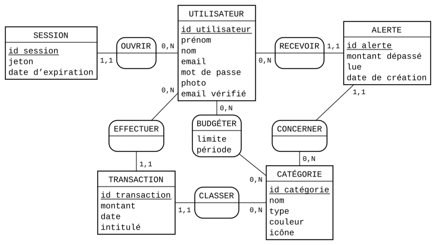

# Base de données — La Pince

Conception et description de la base : règles de gestion, modèles conceptuel (MCD), logique (MLD) et physique (MPD), dictionnaire de données, intégrité, sécurité.

Sources de vérité : le schéma [apps/api/prisma/schema.prisma](../apps/api/prisma/schema.prisma) et les migrations SQL [apps/api/prisma/migrations/](../apps/api/prisma/migrations/). Ce document les explique ; en cas d'écart, ce sont eux qui font foi.

---

## 1. Pourquoi une base relationnelle (PostgreSQL)

- **Des données liées par nature** : un utilisateur a des dépenses, chacune rangée dans une catégorie ; un budget porte sur une catégorie. Les clés étrangères garantissent ces liens (pas de dépense rattachée à une catégorie qui n'existe pas).
- **De l'argent** : montants exacts au centime (`DECIMAL(12, 2)`), là où un nombre à virgule flottante donnerait 0,10 + 0,20 = 0,30000000000000004.
- **Des écritures qui vont ensemble** : une dépense et l'alerte de son budget sont enregistrées dans une même transaction (tout ou rien), avec un verrou contre les requêtes simultanées (section 7).
- **Des calculs** : totaux par mois, par catégorie, dépassements, que SQL et les index font efficacement.

PostgreSQL 17, piloté par l'ORM Prisma (requêtes typées, migrations versionnées).

---

## 2. Règles de gestion

| # | Règle |
|---|---|
| RG1 | Un utilisateur s'inscrit avec un prénom, un nom, un email et un mot de passe. L'email est **unique** et insensible à la casse (enregistré en minuscules). Le compte reste non vérifié tant que l'email n'est pas confirmé. |
| RG2 | Le mot de passe compte au moins 8 caractères, dont une majuscule, un chiffre et un caractère spécial. Il n'est jamais stocké en clair (haché avec Argon2). |
| RG3 | Les **catégories** sont communes à tous les utilisateurs (39, créées par le seed), de type **dépense** ou **revenu**, avec un nom unique. Les utilisateurs ne les modifient pas. |
| RG4 | Une **transaction** appartient à un seul utilisateur et à une seule catégorie ; son type (dépense ou revenu) est celui de sa catégorie. Montant strictement positif, au centime, inférieur à 10 milliards ; date au jour ; intitulé facultatif (255 caractères au plus). |
| RG5 | Un utilisateur a **au plus un budget par catégorie**. Un budget a une limite (positive, au centime) et une période : **mensuelle** (mois civil en cours) ou **hebdomadaire** (du lundi au dimanche). |
| RG6 | Un budget est **dépassé** quand ses dépenses de la période en cours excèdent sa limite. Il existe alors **une alerte** (au plus une par utilisateur et par catégorie), avec le montant du dépassement, lue ou non. Elle disparaît quand le dépassement disparaît (dépense supprimée, limite relevée, budget supprimé, nouvelle période). |
| RG7 | Un utilisateur peut être connecté sur plusieurs appareils : **5 sessions au plus**, la plus ancienne est fermée au-delà. Une session expire au bout de 7 jours. |
| RG8 | Mot de passe oublié : un lien à **usage unique**, valable **30 minutes** ; changer de mot de passe ferme toutes les sessions. |
| RG9 | Supprimer son compte supprime **toutes ses données** (sessions, transactions, budgets, alertes). Une catégorie utilisée par une transaction ou un budget ne peut pas être supprimée. |

---

## 3. Modèle conceptuel de données (MCD)



Formalisme Merise, cardinalités (minimum, maximum) lues depuis l'entité : un utilisateur **effectue** 0 à N transactions ; une transaction est effectuée par 1 et 1 seul utilisateur.

- **BUDGÉTER** est une association porteuse entre UTILISATEUR et CATÉGORIE (attributs : limite, période). Elle traduit RG5 : le couple (utilisateur, catégorie) identifie un budget, il ne peut donc y en avoir qu'un.
- **ALERTE** est une entité : elle a sa propre vie (lue ou non, date de création). « Au plus une alerte par utilisateur et par catégorie » (RG6) est garanti par l'application, sous un verrou par utilisateur et par catégorie (section 7).
- **SESSION** représente une connexion ouverte sur un appareil (RG7).

Source du schéma : [mcd/la-pince.mcd](mcd/la-pince.mcd), au format texte de [Mocodo](https://www.mocodo.net/), versionné avec le code. Pour regénérer l'image (SVG et PNG) après une modification, depuis la racine du dépôt (PowerShell) :
```powershell
docker run --rm -v "${PWD}/docs/mcd:/mcd" -w /mcd python:3.12-slim sh -c "apt-get -qq update && apt-get -qq install -y libcairo2 && pip install -q mocodo cairosvg && mocodo -i la-pince.mcd --language fr --svg_to png"
```

---

## 4. Modèle logique de données (MLD)

Clés primaires soulignées, clés étrangères précédées de `#` :

- **UTILISATEUR** (<u>id utilisateur</u>, prénom, nom, email, mot de passe, photo, email vérifié)
- **SESSION** (<u>id session</u>, jeton, date d'expiration, #id utilisateur)
- **CATÉGORIE** (<u>id catégorie</u>, nom, type, couleur, icône)
- **TRANSACTION** (<u>id transaction</u>, montant, date, intitulé, #id utilisateur, #id catégorie)
- **BUDGÉTER** (<u>#id utilisateur, #id catégorie</u>, limite, période)
- **ALERTE** (<u>id alerte</u>, montant dépassé, lue, date de création, #id utilisateur, #id catégorie)

Passage du MCD au MLD : chaque entité devient une table ; une association 1,1 – 0,N devient une clé étrangère du côté 1,1 ; l'association porteuse BUDGÉTER (0,N – 0,N) devient une table dont la clé est le couple des deux clés étrangères.

---

## 5. Modèle physique (MPD) et convention de nommage

Le MPD est le SQL exécuté par PostgreSQL : les **migrations** versionnées, appliquées dans l'ordre par `prisma migrate deploy` au démarrage de l'API.

| Migration | Contenu |
|---|---|
| [0_init](../apps/api/prisma/migrations/0_init/migration.sql) | création des types énumérés, des 6 tables, des index, des contraintes d'unicité et des 7 clés étrangères |
| [20261030140000_naming_convention_and_money](../apps/api/prisma/migrations/20261030140000_naming_convention_and_money/migration.sql) | convention de nommage ci-dessous et montants en `DECIMAL(12, 2)`, écrite à la main (renommages seulement, aucune donnée supprimée) |
| [20261031120000_hash_session_tokens](../apps/api/prisma/migrations/20261031120000_hash_session_tokens/migration.sql) | jetons de session et de confirmation d'email stockés sous forme d'empreinte SHA-256 (`token_hash`, `email_verification_token_hash`), écrite à la main : renommages, puis jetons existants hachés sur place, les sessions ouvertes restent valides |

**Convention de nommage** :
- tables au pluriel, en minuscules : `users`, `transactions`, `categories` ;
- colonnes en snake_case : `created_at`, `email_verified` ;
- clé primaire `id`, entier auto-incrémenté ;
- clés étrangères `<entité>_id` : `user_id`, `category_id` ;
- types énumérés en snake_case : `period_type`, `category_type` ;
- contraintes et index nommés d'après la table et les colonnes : `budgets_user_id_category_id_key`, `transactions_user_id_fkey`.

Le code garde ses noms (champs Prisma, donc API) : `@map` et `@@map` dans `schema.prisma` font la correspondance (`userId` ↔ `user_id`).

**Écarts assumés entre MLD et MPD** :
- `budgets` a une clé technique `id` (identifiant stable dans l'API : `/budgets/12`) ; l'identifiant du MLD (utilisateur, catégorie) devient une **contrainte d'unicité** `UNIQUE (user_id, category_id)`, qui garantit RG5 de la même façon.
- Colonnes techniques absentes du MCD : dates de création et de modification, jetons de vérification et de réinitialisation (section 6).
- Table `_prisma_migrations` : historique des migrations appliquées, géré par Prisma.

---

## 6. Dictionnaire de données

Types PostgreSQL. `NN` : obligatoire (`NOT NULL`). `PK` : clé primaire, `FK` : clé étrangère, `UQ` : unique.

### `users` — utilisateurs

| Colonne | Type | Contraintes | Description |
|---|---|---|---|
| `id` | `INTEGER` | PK, auto-incrément | identifiant |
| `first_name` | `TEXT` | NN | prénom |
| `last_name` | `TEXT` | NN | nom |
| `email` | `TEXT` | NN, UQ | email de connexion, en minuscules (RG1) |
| `password` | `TEXT` | NN | **hash Argon2** du mot de passe, jamais le mot de passe (RG2) |
| `photo` | `TEXT` | | photo de profil (facultative) |
| `email_verified` | `BOOLEAN` | NN, défaut `false` | email confirmé |
| `email_verification_token_hash` | `TEXT` | | **hash SHA-256** du jeton aléatoire (UUID v4) du lien de confirmation ; effacé une fois l'email vérifié |
| `password_reset_token_hash` | `TEXT` | UQ | **hash SHA-256** du jeton de réinitialisation ; le jeton en clair n'existe que dans l'email (RG8) |
| `password_reset_expires_at` | `TIMESTAMP(3)` | | fin de validité du lien de réinitialisation (30 min) |
| `created_at` | `TIMESTAMP(3)` | NN, défaut maintenant | création du compte |
| `updated_at` | `TIMESTAMP(3)` | NN | dernière modification (mise à jour par Prisma) |

### `refresh_tokens` — sessions

| Colonne | Type | Contraintes | Description |
|---|---|---|---|
| `id` | `INTEGER` | PK | identifiant |
| `token_hash` | `TEXT` | NN, UQ | **hash SHA-256** du jeton de rafraîchissement de la session (JWT signé, qui n'existe en clair que dans le cookie) ; sa présence en base permet de fermer une session (déconnexion, changement de mot de passe) ; supprimé à chaque utilisation (rotation) |
| `user_id` | `INTEGER` | NN, FK → `users`, suppression en cascade | propriétaire |
| `expires_at` | `TIMESTAMP(3)` | NN | fin de validité (7 jours, RG7) |
| `created_at`, `updated_at` | `TIMESTAMP(3)` | NN | dates de création et de modification |

### `categories` — catégories

| Colonne | Type | Contraintes | Description |
|---|---|---|---|
| `id` | `INTEGER` | PK | identifiant |
| `name` | `TEXT` | NN, UQ | nom affiché (« Logement », « Salaire »…) |
| `type` | `category_type` | NN | `EXPENSE` (dépense) ou `INCOME` (revenu) ; donne le type des transactions (RG3, RG4) |
| `color` | `TEXT` | | couleur d'affichage |
| `icon` | `TEXT` | | icône d'affichage |
| `created_at`, `updated_at` | `TIMESTAMP(3)` | NN | dates de création et de modification |

### `transactions` — dépenses et revenus

| Colonne | Type | Contraintes | Description |
|---|---|---|---|
| `id` | `INTEGER` | PK | identifiant |
| `amount` | `DECIMAL(12, 2)` | NN | montant positif, au centime ; le signe vient du type de la catégorie (RG4) |
| `date` | `TIMESTAMP(3)` | NN | jour de la transaction (saisi au jour, enregistré à minuit UTC) |
| `description` | `TEXT` | | intitulé facultatif ; sans lui, l'interface affiche la catégorie |
| `user_id` | `INTEGER` | NN, FK → `users`, suppression en cascade | propriétaire |
| `category_id` | `INTEGER` | NN, FK → `categories`, suppression **interdite** | catégorie (RG9) |
| `updated_at` | `TIMESTAMP(3)` | NN, défaut maintenant | dernière modification |

Index : `(user_id)` et `(user_id, date)` — la liste des transactions d'un utilisateur est lue triée par date, page par page.

### `budgets` — budgets

| Colonne | Type | Contraintes | Description |
|---|---|---|---|
| `id` | `INTEGER` | PK | identifiant |
| `limit_amount` | `DECIMAL(12, 2)` | NN | limite, positive, au centime |
| `period` | `period_type` | NN | `monthly` (mois civil) ou `weekly` (lundi → dimanche) ; `custom` existe dans le type mais est refusé par l'API (aucune date n'est enregistrée pour le calculer) |
| `user_id` | `INTEGER` | NN, FK → `users`, suppression en cascade | propriétaire |
| `category_id` | `INTEGER` | NN, FK → `categories`, suppression interdite | catégorie suivie |
| `created_at`, `updated_at` | `TIMESTAMP(3)` | NN | dates de création et de modification |

Contrainte `UNIQUE (user_id, category_id)` : un seul budget par utilisateur et par catégorie (RG5). Index : `(user_id)`.

### `alerts` — alertes de dépassement

| Colonne | Type | Contraintes | Description |
|---|---|---|---|
| `id` | `INTEGER` | PK | identifiant |
| `exceeded_amount` | `DECIMAL(12, 2)` | NN | montant du dépassement sur la période en cours |
| `is_read` | `BOOLEAN` | NN, défaut `false` | alerte vue par l'utilisateur |
| `user_id` | `INTEGER` | NN, FK → `users`, suppression en cascade | destinataire |
| `category_id` | `INTEGER` | NN, FK → `categories`, suppression en cascade | catégorie dépassée |
| `created_at` | `TIMESTAMP(3)` | NN, défaut maintenant | date de l'alerte |

Index : `(user_id)`.

### Types énumérés

| Type | Valeurs |
|---|---|
| `category_type` | `EXPENSE`, `INCOME` |
| `period_type` | `weekly`, `monthly`, `custom` (refusé par l'API) |

---

## 7. Intégrité des données

**Dans la base** :
- clés primaires, `NOT NULL` sur toute donnée obligatoire ;
- **clés étrangères** : suppression **en cascade** depuis `users` (RG9 : supprimer un compte supprime ses données) ; suppression **interdite** (`RESTRICT`) d'une catégorie utilisée par une transaction ou un budget ;
- contraintes d'**unicité** : email, nom de catégorie, hash du jeton de session, hash du jeton de réinitialisation, budget par utilisateur et catégorie ;
- montants en `DECIMAL(12, 2)` : exacts au centime.

**Dans l'API**, avant la base :
- validation de chaque entrée (Zod) : montants au centime et sous 10 milliards, formats, longueurs → 400 avec le message sous le champ en cause, plutôt qu'une erreur de la base ;
- chaque requête filtre sur l'utilisateur connecté (`user_id`) : un utilisateur ne lit ni ne modifie les données d'un autre ;
- **transactions** : l'écriture d'une dépense ou d'un budget et le recalcul des alertes des catégories touchées se font dans une seule transaction PostgreSQL (tout ou rien) ;
- **accès concurrents** : un verrou par utilisateur et par catégorie (`pg_advisory_xact_lock`, libéré à la fin de la transaction) fait passer les requêtes simultanées l'une après l'autre ; c'est lui qui garantit « une seule alerte » (RG6). Prouvé par un test : 8 dépenses envoyées en même temps donnaient 2 à 4 alertes avant ce verrou, 1 après ([docs/tests.md](tests.md)).

---

## 8. Sécurité et confidentialité

- **Aucun secret en clair** : mots de passe hachés avec Argon2 ; jetons (session, confirmation d'email, réinitialisation) stockés sous forme de hash SHA-256. Une fuite de la base ne donne ni mot de passe ni jeton utilisable. SHA-256 suffit pour les jetons, aléatoires et longs, qu'on ne peut pas deviner par essais successifs ; Argon2, volontairement lent, protège les mots de passe, choisis par des humains.
- **Minimisation** : seules les données utiles au service sont demandées (prénom, nom, email ; la photo est facultative).
- **Droit à l'effacement** : la suppression du compte efface toutes les données de l'utilisateur, par les clés étrangères en cascade.
- **Isolation** : la base n'est pas exposée sur Internet en production (seul le reverse proxy l'est) ; l'API filtre chaque requête par utilisateur.
- **Sauvegarde et restauration** : `pg_dump` avant chaque mise en production (fait par le script de déploiement), restauration vérifiée sur une base jetable : [deploiement-serveur.md](deploiement-serveur.md), section 5.

---

## 9. Jeu d'essai et base de test

- **Seed** ([apps/api/prisma/seed.ts](../apps/api/prisma/seed.ts)) : les 39 catégories, créées ou mises à jour au démarrage de l'API (idempotent).
- **Base de test** `lapince_test` : mêmes migrations et même seed, utilisée par les tests d'intégration, qui refusent de tourner sur une autre base ([docs/tests.md](tests.md)).
