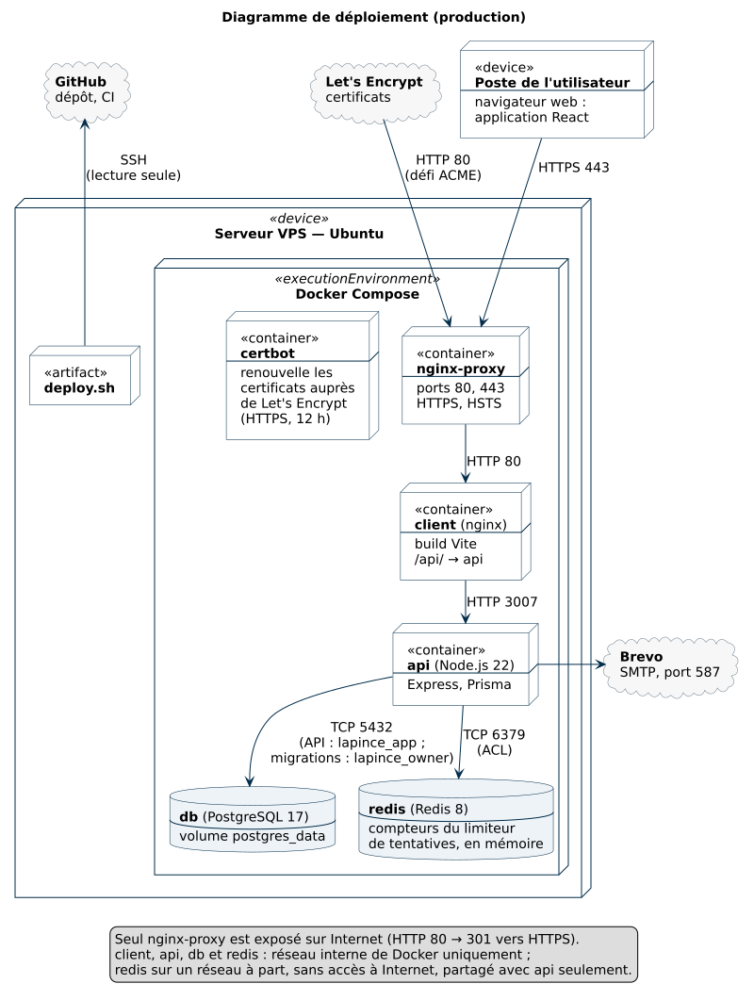

# Déploiement — La Pince

Site : https://mehdicherki.fr
Serveur : VPS Linux, dépôt cloné dans `/opt/lapince`.
Dépôt : `MehdiCherki/Lapince` sur GitHub, branche `main`.

> Aucun secret dans ce fichier : mots de passe, clés et jetons restent dans le `.env` du serveur.

---

## 1. Architecture de la prod

Diagramme de déploiement UML (source : [diagrammes/deploiement.puml](diagrammes/deploiement.puml), PlantUML) :



Les sources et la commande pour regénérer tous les schémas sont dans [diagrammes/README.md](diagrammes/README.md).

En résumé :

```
Internet ──► nginx-proxy (:80, :443) ──► client (nginx, fichiers du build Vite)
                 │                          └── /api/ ──► api (:3007) ──► db (PostgreSQL)
                 │                                            └──────────► redis (réseau interne à part)
                 └── /.well-known/acme-challenge/ ◄── certbot (renouvellement HTTPS)
```

| Service | Rôle |
|---|---|
| `db` | PostgreSQL 17, données dans le volume `postgres_data`. Trois comptes : l'administrateur (`POSTGRES_USER`, superutilisateur : administration et sauvegardes), `lapince_owner` (propriétaire du schéma : migrations et seed), `lapince_app` (l'API : données seulement) ; voir [base-de-donnees.md](base-de-donnees.md), section 9 |
| `redis` | Redis 8 : compteurs du limiteur de tentatives de l'API (connexion, inscription, session, mot de passe oublié). Sur un réseau Docker interne, partagé avec `api` seulement, sans accès à Internet ; aucun port publié. Un seul utilisateur, `lapince_app`, limité aux commandes du limiteur et aux clés `rl:*` ; `default` désactivé ([redis/start.sh](../redis/start.sh)). Aucune persistance : un redémarrage remet les compteurs à zéro (fenêtres de 15 min à 1 h) |
| `api` | API compilée (`node dist/…`). Au démarrage ([apps/api/docker-start.sh](../apps/api/docker-start.sh)) : `prisma migrate deploy` (applique les migrations versionnées non encore jouées), puis seed des catégories, avec `lapince_owner` ; puis le serveur, avec `lapince_app` |
| `client` | nginx qui sert le front et relaie `/api/` vers `api` |
| `nginx-proxy` | Seul service exposé (ports 80 et 443). HTTP → HTTPS, `www` → domaine nu. Recharge sa configuration toutes les 6 h pour servir un certificat renouvelé |
| `certbot` | Tente un renouvellement toutes les 12 h, en mode **webroot** |

Tous les services ont `restart: unless-stopped` : ils repartent seuls après un redémarrage du serveur.

Toutes les commandes ci-dessous se lancent depuis `/opt/lapince`, avec cet alias :

```bash
cd /opt/lapince
alias dc='docker compose -f docker-compose.prod.yml'
```

### Le `.env` du serveur

Copie de `.env.example`, avec ces valeurs propres à la prod :

```env
NODE_ENV=production
DATABASE_URL=postgresql://lapince_app:<mot de passe de lapince_app>@db:5432/<POSTGRES_DB>
MIGRATION_DATABASE_URL=postgresql://lapince_owner:<mot de passe de lapince_owner>@db:5432/<POSTGRES_DB>
FRONTEND_URL=https://mehdicherki.fr
ALLOWED_ORIGINS=https://mehdicherki.fr
VITE_API_BASE_URL=/api
REDIS_PASSWORD=<valeur générée, voir ci-dessous>
```

Les ports locaux (`*_LOCAL_PORT`) ne servent pas en prod : seul `nginx-proxy` est exposé.

`DATABASE_URL` et `MIGRATION_DATABASE_URL` (depuis la 0.9.7) : l'API se connecte avec le rôle `lapince_app`, les migrations et le seed avec `lapince_owner` ; `POSTGRES_USER` et `POSTGRES_PASSWORD` ne servent plus qu'à l'administrateur (sauvegardes, création des rôles). Les mots de passe des rôles sont générés sur le serveur, sans être affichés, au moment de leur création (section 2, « comptes PostgreSQL séparés ») ; ils ne sont écrits que dans ces deux adresses. Sans `MIGRATION_DATABASE_URL`, aucune commande `dc` ne démarre ; `deploy.sh` vérifie que chaque adresse désigne le bon rôle, sans lire le mot de passe.

`REDIS_PASSWORD` (depuis la 0.9.6) : mot de passe de l'utilisateur Redis `lapince_app`, propre au serveur, jamais réutilisé ailleurs. Le générer sur le serveur, sans l'afficher, puis l'ajouter au `.env` :

```bash
printf 'REDIS_PASSWORD=%s\n' "$(openssl rand -base64 32)" >> .env
grep -c '^REDIS_PASSWORD=.' .env   # 1 : présent une seule fois (la valeur n'est pas affichée)
```

Sans lui, aucune commande `dc` ne démarre (« REDIS_PASSWORD manquant dans .env ») et `deploy.sh` s'arrête dès ses préconditions. Seul Redis et l'API le lisent : Redis l'écrit au démarrage dans un fichier d'ACL lisible par son seul utilisateur, jamais sur la ligne de commande. `REDIS_URL` n'est pas dans le `.env` : `redis://redis:6379`, fixé dans `docker-compose.prod.yml`.

> Ce document décrit le serveur **existant**. L'installation complète d'un nouveau serveur (Docker, premier certificat) n'est pas décrite ici, car elle n'a pas été rejouée depuis la mise en place.

---

## 2. Mettre en production une nouvelle version

Prérequis : la version est mergée dans `main` (CI verte).

### Avec le script (méthode normale)

```bash
cd /opt/lapince
./deploy/deploy.sh --check   # vérifie seulement : préconditions, commits à déployer ; rien n'est modifié
./deploy/deploy.sh           # déploie
```

[deploy/deploy.sh](../deploy/deploy.sh) enchaîne les étapes de la procédure manuelle (plus bas) et **s'arrête à la première erreur** :

| Étape | Ce que fait le script | Arrêt si |
|---|---|---|
| 1. Préconditions | dossier, branche `main`, aucune modification locale, `REDIS_PASSWORD` présent dans `.env` (sans afficher sa valeur), `MIGRATION_DATABASE_URL` sur le rôle `lapince_owner` et `DATABASE_URL` sur `lapince_app` (seul le nom du rôle est vérifié), base démarrée, rôles créés et propriétaires des objets du schéma ; liste les commits à déployer ; regarde si la base est inscrite aux migrations | une condition manque (ou rien à déployer : sortie normale) |
| 2. Sauvegarde | `pg_dump` vers `~/backup-lapince-AAAA-MM-JJ-HHMM.sql` ; une fois vérifiée, seules les 5 sauvegardes les plus récentes sont gardées (`KEEP_BACKUPS=n ./deploy/deploy.sh` pour en garder un autre nombre) | fichier incomplet (ligne de fin de `pg_dump` absente) : rien n'est supprimé |
| 3. Mise à jour | `git pull --ff-only` ; note le commit précédent, point de retour | historique divergent |
| 4. Build | `dc build` | erreur de build |
| 5. Inscription aux migrations | **une seule fois** (0.9.0) : contrôles 1 et 2 de l'encadré ci-dessous, puis inscription de `0_init` | un contrôle différent de 0 |
| 6. Redémarrage | `dc up -d` ; le script attend que Redis soit sain (1 min au plus) ; l'API applique les migrations, se connecte à Redis, puis démarre ; le script attend « Server started » (2 min au plus) | Redis n'est pas sain, l'API redémarre en boucle ou ne démarre pas |
| 7. nginx | rechargement de `nginx-proxy` (sans lui : 502, incident de la 0.8.0) | — |
| 8. Contrôles | tous les services démarrés ; base conforme au schéma ; site 200 ; API 401 | un contrôle échoue |

En cas d'arrêt, le script **n'annule rien tout seul** : restaurer une base est une décision humaine. Il affiche les commandes de retour arrière (étape D), avec le commit et la sauvegarde à utiliser. Journal de chaque exécution : `~/deploy-logs/`. `--redeploy` reconstruit et relance l'API et le client même sans nouveau commit (par exemple après un échec corrigé).

Puis, dans le navigateur : connexion, ajout d'une transaction, tableau de bord.

**Première utilisation (0.9.0)** : le script arrive avec cette version, il n'est donc pas encore sur le serveur. Le lancer depuis `origin/main`, sans toucher au dépôt :
```bash
git fetch origin main && git show origin/main:deploy/deploy.sh > ~/deploy.sh
bash ~/deploy.sh --check
bash ~/deploy.sh
```

**Testé** : [deploy/deploy.test.sh](../deploy/deploy.test.sh) exécute le script avec des doubles de `git`, `docker` et `curl` : 30 scénarios (déploiement normal, sauvegarde incomplète, site en 502, API en boucle, inscription de la 0.9.0 avec des contrôles verts ou non, rétention des sauvegardes, `REDIS_PASSWORD` absent ou vide, Redis non sain, adresse de migration absente ou sur un autre rôle, API encore sur l'administrateur, rôles non créés ou objets non transférés…), 102 vérifications, dont « aucun mot de passe (Redis, PostgreSQL) n'apparaît ni à l'écran ni dans le journal », lancées par la CI à chaque PR, avec ShellCheck. Contre-épreuves : 6 sabotages du script (sans rechargement de nginx, sauvegarde non vérifiée, décimales non contrôlées, contrôle 1 sur le mauvais schéma, une sauvegarde de trop gardée, rétention avant la vérification), tous détectés ; le script de la 0.9.6 échoue à 15 des vérifications ajoutées pour la 0.9.7. Exécuté en réel pour la 0.9.0 et la 0.9.1.

### Une seule fois : inscription de la base aux migrations (0.9.0)

Le script fait cette étape (5) tout seul. Commandes équivalentes, pour comprendre ou pour le faire à la main :

> **Une seule fois, au premier déploiement avec migrations (0.9.0)** : la base de prod existait avant les migrations versionnées. Avant de lancer la nouvelle version, il faut l'inscrire comme déjà conforme à la migration initiale `0_init`, sinon `migrate deploy` refuse de démarrer (base non vide). La 0.9.0 apporte aussi une deuxième migration (nommage des tables et colonnes, montants en `DECIMAL(12, 2)`) : l'API l'applique elle-même au démarrage, à l'étape B.
>
> Après l'étape A et `git pull`, avant `dc up -d --build` :
> ```bash
> dc build api
> # 1. La base doit être identique à 0_init, c'est-à-dire au schéma du commit 673dcd2.
> #    Pas au schéma actuel : il contient déjà la migration suivante (le contrôle afficherait 2).
> git show 673dcd2:apps/api/prisma/schema.prisma | dc run --rm -T --entrypoint sh api -c 'cat > /tmp/0_init.prisma && npx prisma migrate diff --from-config-datasource --to-schema /tmp/0_init.prisma --exit-code'; echo $?   # doit afficher 0
> # 2. Aucun montant à plus de 2 décimales (DECIMAL(12, 2) l'arrondirait au centime)
> echo 'SELECT count(*) FROM transactions WHERE amount <> round(amount, 2) UNION ALL SELECT count(*) FROM budgets WHERE limit_amount::numeric <> round(limit_amount::numeric, 2) UNION ALL SELECT count(*) FROM alerts WHERE "exceededAmount" <> round("exceededAmount", 2);' | dc exec -T db sh -c 'psql -U "$POSTGRES_USER" -d "$POSTGRES_DB" -At'   # doit afficher 0 sur les 3 lignes
> # 3. Inscription
> dc run --rm --entrypoint npx api prisma migrate resolve --applied 0_init
> ```
> **Si le contrôle 1 n'affiche pas `0` : STOP.** La base diffère de `0_init` ; l'inscrire ferait croire à un historique faux. Afficher les différences (même commande sans `--exit-code`) et les comprendre avant d'aller plus loin.
> **Si le contrôle 2 n'affiche pas `0` partout : STOP.** Regarder les montants concernés avant de continuer : l'arrondi au centime doit être constaté, pas subi.
>
> Puis étape B. En C, ajouter le contrôle final (doit afficher `0`) :
> ```bash
> dc exec api npx prisma migrate diff --from-config-datasource --to-schema prisma/schema.prisma --exit-code; echo $?
> ```
> **Retour arrière** : la 0.8.0 ne connaît pas les nouveaux noms de colonnes ; revenir au code précédent impose de restaurer aussi la sauvegarde de l'étape A (section 5).
>
> Procédure **répétée le 30/10/2026** sur une copie restaurée de la sauvegarde de prod (section 5) : sans inscription, `migrate deploy` refuse (erreur P3005, base non vide) ; avec la copie dans l'état de la prod actuelle, contrôle d'écart à `0`, inscription, `migrate deploy` (« No pending migrations »), seed, écart final à `0`, données intactes.
> Contrôle 1 vérifié le 30/10/2026 sur une base créée à l'état `0_init` : `0` avec le schéma de 673dcd2, `2` avec le schéma actuel ; puis inscription, migration de nommage appliquée par `migrate deploy`, écart final à `0`.
> Procédure 0.9.0 complète **répétée le 30/10/2026** sur une copie de la sauvegarde de prod du jour (6 utilisateurs, 6 transactions, 3 budgets, 1 alerte) : contrôles 1 et 2 à `0`, `deploy` sans inscription refusé (P3005), inscription, migration de nommage appliquée, empreinte (MD5) du contenu de chaque table identique avant et après, sommes des montants identiques, seed, écart final à `0`. Copie et base jetable supprimées ensuite.

### Une seule fois : arrivée de Redis (0.9.6)

La 0.9.6 ajoute le service `redis`. Aucune migration de la base. Avant le déploiement :

**1. Contrôles préalables, en lecture seule** (aucune adresse IP n'est affichée, seulement des nombres) :
```bash
cd /opt/lapince
# a. Le limiteur compte par adresse de visiteur : nginx-proxy doit voir les adresses publiques.
#    Requêtes des dernières 24 h reçues depuis une adresse privée, puis total :
dc logs --no-log-prefix --since 24h nginx-proxy 2>/dev/null | awk '{print $1}' | grep -cE '^(10\.|172\.(1[6-9]|2[0-9]|3[01])\.|192\.168\.|127\.)'   # 0 attendu
dc logs --no-log-prefix --since 24h nginx-proxy 2>/dev/null | wc -l
# b. Mémoire libre (Redis en prend 32 Mo au plus)
free -m
# c. Nom du réseau interne libre
docker network ls --format '{{.Name}}' | grep -c '^lapince_redis$'   # 0 attendu
```
**Si a n'affiche pas `0` : STOP.** Des visiteurs arrivent avec une adresse interne de Docker : ils partageraient un même compteur, et un seul d'entre eux pourrait bloquer la connexion de tous. À comprendre avant d'aller plus loin (c'est déjà le cas pour le limiteur en mémoire de la 0.9.5).

**2. Mot de passe** : générer `REDIS_PASSWORD` et l'ajouter au `.env` (section 1).

**3. Déployer avec le script de la 0.9.6**, qui contrôle déjà `REDIS_PASSWORD` et l'état de Redis (celui du serveur est encore celui de la 0.9.5). Comme pour la 0.9.0, le lancer depuis `origin/main` sans toucher au dépôt :
```bash
git fetch origin main && git show origin/main:deploy/deploy.sh > ~/deploy.sh
bash ~/deploy.sh --check
bash ~/deploy.sh
```

**4. Contrôles propres à Redis** :
```bash
dc ps redis                                     # Up (healthy)
dc logs api --tail 30 | grep -c "Redis : connecté"   # 1 au moins
dc ps redis --format '{{.Ports}}'              # 6379/tcp, sans « -> » : aucun port publié
dc exec -T redis redis-cli ping                 # NOAUTH Authentication required. (mot de passe obligatoire)
# Compteur conservé quand l'API redémarre (corps vide → 400, tentative comptée) :
curl -s -o /dev/null -D - -X POST https://mehdicherki.fr/api/auth/login -H 'Content-Type: application/json' -d '{}' | grep -i '^ratelimit-remaining'   # 9
dc restart api && sleep 15
curl -s -o /dev/null -D - -X POST https://mehdicherki.fr/api/auth/login -H 'Content-Type: application/json' -d '{}' | grep -i '^ratelimit-remaining'   # 8, et non 9
```
Ces deux essais comptent dans la limite de 10 connexions par 15 minutes de l'adresse du serveur, sans gêner les visiteurs.

**Retour arrière** : aucune donnée de la base n'a changé, la sauvegarde n'est pas à restaurer.
```bash
git checkout <commit de la 0.9.5> && dc up -d --build --remove-orphans   # --remove-orphans : retire le conteneur redis
dc exec nginx-proxy nginx -s reload
docker network rm lapince_redis
```
`REDIS_PASSWORD` peut rester dans le `.env` : la 0.9.5 ne le lit pas.

### Une seule fois : comptes PostgreSQL séparés (0.9.7)

La 0.9.7 sépare les comptes de la base ([base-de-donnees.md](base-de-donnees.md), section 9) : l'API ne se connecte plus avec le superutilisateur. Les rôles doivent exister, et posséder les objets du schéma, **avant** le déploiement : la nouvelle API ne démarre pas sans eux, et `deploy.sh` s'arrête dès ses préconditions tant qu'ils manquent. Une migration, qui ne change que des droits (aucune donnée). Tout se lance depuis `/opt/lapince`, **dans un même terminal** : les mots de passe générés à l'étape 3 restent dans des variables du shell jusqu'à l'étape 4.

**1. Sauvegarde** (hors de la rotation de `deploy.sh`, qui en fera une autre) :
```bash
cd /opt/lapince
F=~/sauvegarde-avant-0.9.7-$(date +%F-%H%M).sql
dc exec -T db sh -c 'pg_dump -U "$POSTGRES_USER" "$POSTGRES_DB"' > "$F"
grep -c "PostgreSQL database dump complete" "$F"   # 1
```

**2. Contrôles préalables, en lecture seule** :
```bash
q() { echo "$1" | dc exec -T db sh -c 'psql -X -U "$POSTGRES_USER" -d "$POSTGRES_DB" -At'; }
q 'SHOW server_version;'        # 17.x : CREATE est déjà retiré à PUBLIC sur le schéma public (depuis la 15)
q 'SHOW password_encryption;'   # scram-sha-256 : le serveur ne garde que l'empreinte des mots de passe
q "SELECT count(*) FROM pg_roles WHERE rolname IN ('lapince_owner', 'lapince_app');"   # 0 : noms libres
q "SELECT pg_get_userbyid(relowner), relkind, count(*) FROM pg_class WHERE relnamespace = 'public'::regnamespace AND relkind IN ('r', 'S') GROUP BY 1, 2 ORDER BY 2;"
# <administrateur>|S|6 et <administrateur>|r|7 : 6 séquences et 7 tables (dont _prisma_migrations), à transférer
q "SELECT count(*) FROM pg_type WHERE typnamespace = 'public'::regnamespace AND typtype = 'e';"   # 2 types énumérés
```
**Si les noms ne sont pas libres : STOP.** Quelqu'un a déjà créé ces rôles : comprendre pourquoi avant de continuer (le script les reprendrait et changerait leurs droits).

**3. Création des rôles**, avec le script de la 0.9.7, pris dans `origin/main` sans toucher au dépôt :
```bash
git fetch origin main && git show origin/main:db/roles.sql > ~/roles.sql
# Mots de passe générés dans des variables du shell : jamais affichés, jamais sur une ligne de commande
export LAPINCE_OWNER_PASSWORD="$(openssl rand -hex 32)" LAPINCE_APP_PASSWORD="$(openssl rand -hex 32)"
# -e sans valeur : docker transmet la variable du shell, sans qu'elle apparaisse dans « ps »
dc exec -T -e LAPINCE_OWNER_PASSWORD -e LAPINCE_APP_PASSWORD db sh -c 'psql -X -U "$POSTGRES_USER" -d "$POSTGRES_DB"' < ~/roles.sql
```
Attendu : `lapince_owner` et `lapince_app` à `f` partout sauf `connexion` et `mot_de_passe` (`t`) ; les 15 objets à `lapince_owner` ; les 6 tables de l'application avec `DELETE, INSERT, SELECT, UPDATE`, `_prisma_migrations` avec `—`, les 6 séquences avec `SELECT, USAGE`, les 2 types avec `USAGE (PUBLIC)`. Le script tient en une transaction : en cas d'erreur, il annule tout et n'affiche que le message. L'API en place (0.9.6) continue de tourner : elle utilise encore l'administrateur, qui garde tous les droits ; le transfert ne verrouille les tables que le temps de la transaction (une fraction de seconde).

**4. Le `.env`**, dans le même terminal :
```bash
cp -p .env ~/env-avant-0.9.7 && chmod 600 ~/env-avant-0.9.7   # ancienne DATABASE_URL, pour le retour arrière
DB="$(sed -n 's/^POSTGRES_DB=//p' .env)"; echo "Base : $DB"   # nom de la base (pas un secret), sans guillemets
sed -i '/^DATABASE_URL=/d; /^MIGRATION_DATABASE_URL=/d' .env
# printf est une commande interne du shell : les valeurs n'apparaissent pas dans « ps »
printf 'DATABASE_URL=postgresql://lapince_app:%s@db:5432/%s\nMIGRATION_DATABASE_URL=postgresql://lapince_owner:%s@db:5432/%s\n' \
  "$LAPINCE_APP_PASSWORD" "$DB" "$LAPINCE_OWNER_PASSWORD" "$DB" >> .env
unset LAPINCE_OWNER_PASSWORD LAPINCE_APP_PASSWORD
grep -cE '^(DATABASE_URL=postgresql://lapince_app:|MIGRATION_DATABASE_URL=postgresql://lapince_owner:).' .env   # 2
```
L'API en place n'est pas touchée : elle garde l'environnement de sa création jusqu'à l'étape 5.

**5. Déploiement**, avec le script de la 0.9.7, qui contrôle les comptes (celui du serveur est encore celui de la 0.9.6) :
```bash
git show origin/main:deploy/deploy.sh > ~/deploy.sh
bash ~/deploy.sh --check   # préconditions : adresses des deux rôles, rôles créés, objets transférés
bash ~/deploy.sh
```
Au redémarrage, l'API applique la migration `20261110120000_private_migrations_table` avec `lapince_owner`, puis démarre avec `lapince_app`.

**6. Vérifications** (`q` : étape 2) :
```bash
echo '\du lapince_*' | dc exec -T db sh -c 'psql -X -U "$POSTGRES_USER" -d "$POSTGRES_DB"'   # aucun attribut (ni Superuser, ni Create DB, ni Create role)
dc logs api | grep -E "Applying migration|Server started"   # 20261110120000_private_migrations_table, puis Server started
q "SELECT count(*) FROM pg_class WHERE relnamespace = 'public'::regnamespace AND relkind IN ('r', 'S') AND pg_get_userbyid(relowner) <> 'lapince_owner';"   # 0
# Droits réels de l'API, vus depuis son conteneur, avec son adresse (lecture seule) :
dc exec -T api node -e 'const c=new (require("pg").Client)(process.env.DATABASE_URL);c.connect().then(()=>c.query("SELECT current_user AS role, has_schema_privilege($$public$$, $$CREATE$$) AS creer_table, has_table_privilege($$users$$, $$TRUNCATE$$) AS vider_users, has_table_privilege($$_prisma_migrations$$, $$SELECT$$) AS lire_migrations")).then(r=>console.log(r.rows[0])).finally(()=>c.end())'
# { role: 'lapince_app', creer_table: false, vider_users: false, lire_migrations: false }
```
Puis, dans le navigateur : connexion, ajout d'une transaction, tableau de bord. Ensuite :
```bash
q "SELECT usename, count(*) FROM pg_stat_activity WHERE datname = current_database() AND backend_type = 'client backend' GROUP BY 1;"
# lapince_app, et la session de psql de l'administrateur qui fait la requête
```
Une fois la version validée : `rm ~/env-avant-0.9.7 ~/roles.sql`.

**7. Retour arrière** : aucune donnée n'a changé, la sauvegarde n'est pas à restaurer. Les rôles créés restent, sans effet tant qu'aucune adresse ne les utilise ; l'administrateur garde tous les droits sur les objets transférés.
- L'API ne démarre pas avec les nouveaux comptes, on garde le code de la 0.9.7 : rétablir l'ancienne `DATABASE_URL` (administrateur) dans les deux adresses, puis recréer l'API. `deploy.sh` refusera ensuite de déployer tant que les comptes séparés ne sont pas rétablis : c'est voulu.
  ```bash
  OLD="$(grep '^DATABASE_URL=' ~/env-avant-0.9.7)"
  sed -i '/^DATABASE_URL=/d; /^MIGRATION_DATABASE_URL=/d' .env
  printf '%s\nMIGRATION_%s\n' "$OLD" "$OLD" >> .env
  dc up -d api && dc exec nginx-proxy nginx -s reload
  ```
- Retour à la 0.9.6 :
  ```bash
  cp -p ~/env-avant-0.9.7 .env
  git checkout 11a9c5b && dc up -d --build && dc exec nginx-proxy nginx -s reload
  ```
  La 0.9.6 démarre normalement sur la base migrée : la migration de la 0.9.7 est déjà inscrite, elle ne la rejoue pas (« No pending migrations »).

Procédure **répétée le 10/11/2026** sur une base jetable PostgreSQL 17.9 dans l'état de la prod (créée par l'image de la 0.9.6 avec le superutilisateur d'amorçage, nom à la casse mixte) : script des rôles (13 objets et 2 types transférés), image de production de la 0.9.7 (migration appliquée par `lapince_owner`, API connectée en `lapince_app` d'après `pg_stat_activity`, contrôle final `migrate diff` à `0`, arrêt propre) ; image de la 0.9.6 sur la base migrée : `migrate deploy` sans erreur (« No pending migrations »). Mots de passe absents des journaux du serveur PostgreSQL et de l'API. Pas sur une copie des données de prod, qui ne sortent pas du serveur.

### À la main (référence)

Les mêmes étapes, commande par commande (procédure des versions 0.7.0 et 0.8.0, complétée par leurs leçons).

#### A — Vérifier et sauvegarder

```bash
git status --short          # doit être vide : rien de modifié à la main sur le serveur
git log --oneline -1        # NOTER ce commit : c'est le point de retour arrière
dc exec -T db sh -c 'pg_dump -U "$POSTGRES_USER" "$POSTGRES_DB"' > ~/backup-lapince-$(date +%F-%H%M).sql
grep -c "PostgreSQL database dump complete" "$(ls -t ~/backup-lapince-*.sql | head -1)"   # 1 : la sauvegarde est allée au bout
```

#### B — Déployer

```bash
git pull --ff-only origin main
dc up -d --build
dc exec nginx-proxy nginx -s reload   # sinon 502 : nginx-proxy garde l'adresse de l'ancien conteneur (incident de la 0.8.0)
```

`--build` est indispensable : sans lui, Docker relance les anciennes images.

#### C — Contrôler

```bash
dc ps                       # tous les services « Up », db et redis « healthy »
dc logs api --tail 20       # « Server started », aucune erreur
dc exec api npx prisma migrate diff --from-config-datasource --to-schema prisma/schema.prisma --exit-code; echo $?   # 0 : base conforme au schéma
curl -s -o /dev/null -w "%{http_code}
" https://mehdicherki.fr/api/categories   # 401 (route protégée : l'API répond)
curl -s -o /dev/null -w "%{http_code}
" https://mehdicherki.fr/                 # 200
```

Puis dans le navigateur : connexion, ajout d'une transaction, tableau de bord.

#### D — Retour arrière (si C échoue)

```bash
git checkout <commit noté en A>
dc up -d --build
```

Si le schéma de la base a changé entre les deux versions, restaurer aussi la sauvegarde de l'étape A.

---

## 3. Accès au serveur

### Connexion SSH : par clé uniquement

Le serveur n'accepte que les connexions par **clé SSH** : la connexion par mot de passe est désactivée, y compris pour root. Un robot qui essaie des mots de passe (ce qui arrive en permanence sur tout serveur public) est refusé sans même pouvoir en tenter un.

Réglage : `/etc/ssh/sshd_config.d/00-durcissement.conf`
```
PasswordAuthentication no
PermitRootLogin prohibit-password
KbdInteractiveAuthentication no
```
Le préfixe `00-` compte : sshd garde la **première** valeur lue, et Ubuntu fournit souvent un `50-cloud-init.conf` qui remet `PasswordAuthentication yes`.

Vérifier :
```bash
sshd -T | grep -Ei '^(permitrootlogin|passwordauthentication) '   # prohibit-password, no
```
Depuis un poste, sans clé, la connexion doit être refusée : `ssh -o PubkeyAuthentication=no root@mehdicherki.fr` → `Permission denied (publickey)`.

**Mis en place le 31/10/2026**, avant ce jour le serveur acceptait root par mot de passe. Ordre suivi pour ne pas se bloquer dehors : connexion par clé vérifiée d'abord (`ssh -o PasswordAuthentication=no …`), session de secours gardée ouverte, `sshd -t` (syntaxe) avant le rechargement, puis les deux vérifications ci-dessus depuis un nouveau terminal. Le mot de passe root a été changé dans la foulée et rangé dans un gestionnaire de mots de passe.

> Clé perdue ou nouveau poste : ajouter la clé publique du nouveau poste dans `~/.ssh/authorized_keys` depuis un poste qui a déjà accès ; en dernier recours, console de secours de l'hébergeur (IONOS), dans son interface web.

### Accès du serveur à GitHub

Le serveur lit le dépôt avec une **deploy key** : une clé SSH dédiée, en **lecture seule**, ajoutée dans GitHub → Settings du dépôt → Deploy keys. Elle ne donne accès qu'à ce dépôt et ne permet pas de pousser.

Elle est déclarée dans `~/.ssh/config` sous l'alias `github-lapince`, et l'URL du dépôt (`git remote -v`) utilise cet alias à la place de `github.com`.

---

## 4. Certificats HTTPS

Let's Encrypt, certificat `mehdicherki.fr` (couvre aussi `www.mehdicherki.fr`), stocké dans `/etc/letsencrypt` sur le serveur.

**Renouvellement automatique** : `certbot` dépose un fichier de preuve dans le volume `certbot_webroot`, que `nginx-proxy` sert sur `/.well-known/acme-challenge/`. Pas besoin d'arrêter nginx.

> ⚠️ Le mode doit rester **webroot**. En août 2026, le certificat avait été obtenu en mode `standalone` : certbot voulait alors ouvrir lui-même le port 80, déjà occupé par nginx. Chaque renouvellement échouait en silence, et le site est devenu inaccessible à l'expiration (14/08/2026).

```bash
# État et date d'expiration
dc run --rm --entrypoint certbot certbot certificates

# Mode de renouvellement : doit afficher « authenticator = webroot »
grep authenticator /etc/letsencrypt/renewal/mehdicherki.fr.conf

# Simulation de renouvellement (ne change rien)
dc run --rm --entrypoint certbot certbot renew --dry-run

# Journal des tentatives de renouvellement
dc logs certbot --tail 30
```

---

## 5. Sauvegarde et restauration de la base

### Sauvegarder

Avant chaque mise en production (le script de déploiement la fait, étape 2), et avant toute opération sur les données :
```bash
dc exec -T db sh -c 'pg_dump -U "$POSTGRES_USER" "$POSTGRES_DB"' > ~/backup-lapince-$(date +%F-%H%M).sql
ls -lh ~/backup-lapince-*.sql      # la nouvelle sauvegarde ne doit pas être vide
```
**Rétention** : le script de déploiement garde les 5 sauvegardes les plus récentes de `~` et supprime les plus anciennes, seulement après avoir vérifié la nouvelle. Une sauvegarde à conserver plus longtemps se copie ailleurs, sous un autre nom.
Le fichier est un script SQL complet (structure + données), lisible et restaurable avec `psql`. Il contient des données personnelles : il reste sur le serveur ; une copie sortie pour un test est supprimée juste après.

### Vérifier qu'une sauvegarde se restaure (sans toucher à la base de prod)

On restaure dans une base **jetable**, puis on compare le nombre de lignes de chaque table avec celui du fichier :
```bash
F=~/backup-lapince-AAAA-MM-JJ.sql
echo "CREATE DATABASE lapince_restore_check;" | dc exec -T db sh -c 'psql -U "$POSTGRES_USER" -d "$POSTGRES_DB"'
dc exec -T db sh -c 'psql -U "$POSTGRES_USER" -d lapince_restore_check -v ON_ERROR_STOP=1 -q' < "$F"
# lignes attendues, d'après le fichier :
awk '/^COPY public\./{t=$2; n=0; on=1; next} on && /^\\\.$/{print t, n; on=0; next} on{n++}' "$F"
# lignes obtenues :
echo "SELECT 'users', count(*) FROM users UNION ALL SELECT 'transactions', count(*) FROM transactions UNION ALL SELECT 'budgets', count(*) FROM budgets UNION ALL SELECT 'alerts', count(*) FROM alerts;" | dc exec -T db sh -c 'psql -U "$POSTGRES_USER" -d lapince_restore_check -At'
echo "DROP DATABASE lapince_restore_check;" | dc exec -T db sh -c 'psql -U "$POSTGRES_USER" -d "$POSTGRES_DB"'
```
`ON_ERROR_STOP=1` : la restauration s'arrête à la première erreur au lieu de continuer à moitié.

> **Restaurer sur une autre machine** (ex. le poste de développement) : si le rôle PostgreSQL n'a pas le même nom (`"Lapince"` en prod, `LaPince` en dev : les guillemets rendent la casse significative), les instructions `ALTER … OWNER TO` échouent. On les retire au passage, comme l'option `--no-owner` de `pg_restore` :
> `sed -E '/^ALTER .* OWNER TO /d' "$F" | psql …`
> Depuis la 0.9.7, les objets appartiennent à `lapince_owner` et les droits visent `lapince_app` : ces noms sont les mêmes partout, il suffit que `db/roles.sql` ait été lancé sur la machine de destination (les rôles existent alors pour tout le serveur PostgreSQL), puis relancé sur la base restaurée.

**Testé le 30/10/2026** : sauvegarde de prod du jour restaurée sur le poste de développement, sans erreur ; nombres de lignes identiques au fichier pour les 6 tables (5 utilisateurs, 6 transactions, 2 budgets, 0 alerte, 39 catégories, 3 sessions) ; copie et base jetable supprimées ensuite.

### Restaurer la base de prod (incident)

Les mêmes commandes, sur la vraie base, API arrêtée pour qu'aucune écriture ne se mêle à la restauration :
```bash
dc stop api
echo 'DROP DATABASE "Lapince"; CREATE DATABASE "Lapince";' | dc exec -T db sh -c 'psql -U "$POSTGRES_USER" -d postgres'
dc exec -T db sh -c 'psql -U "$POSTGRES_USER" -d "$POSTGRES_DB" -v ON_ERROR_STOP=1 -q' < ~/backup-lapince-AAAA-MM-JJ.sql
dc exec -T db sh -c 'psql -X -U "$POSTGRES_USER" -d "$POSTGRES_DB"' < db/roles.sql   # droits sur la base recréée (sans mot de passe : les rôles existent)
dc start api                       # migrate deploy rejoue les migrations postérieures à la sauvegarde, s'il y en a
```
Depuis la 0.9.7, une sauvegarde contient les propriétaires (`lapince_owner`) et les droits des tables (`lapince_app`), mais pas les droits sur la base elle-même (connexion), propres à la base recréée : d'où la relance de `db/roles.sql`, idempotent. Pour une sauvegarde d'avant la 0.9.7 (objets à l'administrateur, aucun droit pour l'API), il transfère aussi les objets et accorde les droits : sans lui, l'API n'aurait accès à aucune table.
Avant de lancer cette restauration réelle, vérifier le fichier par la procédure précédente (base jetable). Cette restauration réelle n'a **pas** été exécutée en prod : seule la restauration de vérification l'a été (30/10/2026) ; les commandes sont les mêmes, appliquées à la base principale.

---

## 6. Commandes utiles

```bash
dc ps                              # état des services
dc logs -f api                     # logs de l'API en continu
dc restart api                     # redémarrer un service (ne relit pas le .env)
dc up -d api                       # recréer un service (relit le .env)
dc exec api sh                     # shell dans l'API
dc exec api npx prisma db seed     # relancer le seed
dc down                            # tout arrêter (les données restent)
```

Redis, avec l'utilisateur de l'API (le mot de passe vient de l'environnement du conteneur, il n'est ni tapé ni affiché). Lister les clés est refusé (`KEYS`, `SCAN` : NOPERM) ; on lit le compteur d'une adresse connue :

```bash
rcli() { dc exec -T redis sh -c 'REDISCLI_AUTH="$REDIS_PASSWORD" redis-cli --user lapince_app "$@"' sh "$@"; }
rcli GET rl:login:203.0.113.10     # tentatives de connexion comptées pour cette adresse
rcli PTTL rl:login:203.0.113.10    # temps restant avant remise à zéro, en millisecondes
rcli DEL rl:login:203.0.113.10     # débloquer une personne bloquée à tort
```

> ⚠️ **Jamais `dc down -v`** : `-v` supprime les volumes, donc la base de production.

---

## 7. En cas de problème

**Service qui redémarre en boucle** : `dc logs <service> --tail 50`.

**Erreur de connexion à la base** : dans `.env`, `DATABASE_URL` (rôle `lapince_app`) et `MIGRATION_DATABASE_URL` (rôle `lapince_owner`) doivent reprendre le mot de passe du rôle et `POSTGRES_DB`, avec l'hôte `db`. « password authentication failed » : le mot de passe de l'adresse diffère de celui du rôle (le redéfinir en relançant `db/roles.sql` avec `LAPINCE_*_PASSWORD`). « permission denied » au démarrage : `db/roles.sql` n'a pas été lancé sur cette base (`./deploy/deploy.sh --check` le signale). Attendre que `db` soit `healthy` (`dc ps`).

**Redis non sain ou API qui attend Redis** : `dc logs redis --tail 30` (« REDIS_PASSWORD manquant », « trop court », « aucun espace ») et `dc logs api --tail 30` (« Redis : erreur de connexion », par exemple `WRONGPASS` si le mot de passe a changé sans recréer les deux services : `dc up -d redis api`). Redis arrêté en cours de route : l'API continue de répondre, les tentatives ne sont plus limitées, et chaque requête concernée est journalisée (« error from store, allowing request without rate-limiting ») jusqu'à son retour ; elle s'y reconnecte seule.

**Site injoignable en HTTPS** : vérifier la date d'expiration du certificat (section 4), puis `dc logs nginx-proxy --tail 30`.

**Rebuild sans cache Docker** :
```bash
dc build --no-cache
dc up -d
```
